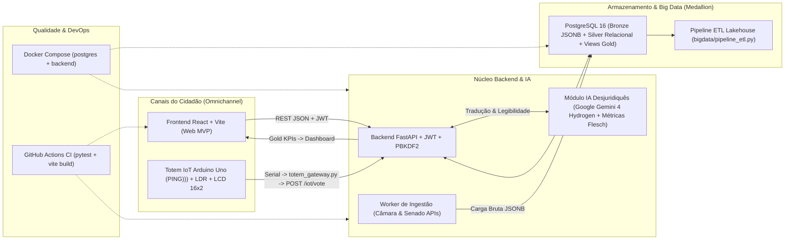

# Quorum — Transparência Legislativa e Participação Cidadã (CitizenTech)

Plataforma **CitizenTech** desenvolvida para a **Global Solution 2026/2 (FIAP — Engenharia de Software)** com foco em reduzir o abismo entre o cidadão brasileiro e o Poder Legislativo. O **Quorum** coleta proposições e dados reais da Câmara dos Deputados e do Senado Federal, traduz o juridiquês para português simples com IA (**Desjuridiquês**), habilita votação cidadã omnichannel (**Web + Totem IoT presencial**) com anonimização criptográfica **LGPD** e consolida indicadores em arquitetura analítica **Medallion (Bronze → Silver → Gold)**.

> **Vídeo Pitch (até 3 minutos):** https://www.youtube.com/watch?v=9Pa_HJvy6no

---

## Conexão com os ODS da ONU (Agenda 2030)

| ODS | Contribuição Concreta da Plataforma Quorum |
| --- | --- |
| **ODS 10 — Redução das Desigualdades** | Democratiza o entendimento das leis por meio da tradução automática em **Desjuridiquês** (com ganho mensurado de legibilidade Flesch pt-BR) e amplia a participação de cidadãos sem acesso contínuo à internet por meio de **Totens IoT presenciais** em locais públicos. |
| **ODS 11 — Cidades e Comunidades Sustentáveis** | Permite que moradores acompanhem e votem em propostas federais, estaduais (**ALESP**) e municipais (**Câmara Municipal de São Paulo**) e monitorem o **Índice de Convergência Cidadão-Parlamento** no painel Panorama Legislativo. |
| **ODS 9 — Indústria, Inovação e Infraestrutura** | Entrega uma infraestrutura digital resiliente e auditável integrando FastAPI, PostgreSQL 16 em camadas Medallion, IA generativa estruturada, IoT embarcado e pipeline CI/CD automatizado. |

---

## Arquitetura Geral da Solução



---

## Estrutura do Monorepo

| Diretório / Arquivo | Área | Responsabilidade Principal |
| --- | --- | --- |
| [`/frontend`](./frontend) | Área 3 (MVP Web) | Aplicação React 18 + TypeScript + Vite + Tailwind CSS com autenticação, Feed Legislativo, Tradutor IA interativo, Casas Legislativas, Perfis Parlamentares/Partidários, Configurações e Dashboard **Panorama Legislativo**. |
| [`/backend`](./backend) | Áreas 3 & 4 (API + DB) | API FastAPI + SQLAlchemy 2.0 + PostgreSQL 16 (`Bronze`/`Silver`), autenticação JWT (`PBKDF2`), hash `SHA-256` LGPD para votos cidadãos, ingestão real de parlamentares e suíte `pytest`. |
| [`/ia`](./ia) | Área 1 (IA & Automação) | Prompt estruturado [`desjuridiques_v1.md`](./ia/prompts/desjuridiques_v1.md), motor Gemini 4 Hydrogen com fallback determinístico offline, cálculo de legibilidade **Flesch pt-BR** e script de benchmark [`evaluate_metrics.py`](./ia/evaluate_metrics.py). |
| [`/bigdata`](./bigdata) | Área 2 (Big Data) | Documentação [`DATA_ARCHITECTURE.md`](./bigdata/DATA_ARCHITECTURE.md), fórmulas SQL/DAX em [`analytics_metrics.md`](./bigdata/analytics_metrics.md), views Gold [`medallion_gold_views.sql`](./bigdata/sql/medallion_gold_views.sql) e ETL [`pipeline_etl.py`](./bigdata/pipeline_etl.py). |
| [`/iot`](./iot) | Área 3 (IoT) | Firmware Arduino Uno R3 [`quorum_voting_totem.ino`](./iot/quorum_voting_totem.ino) (sensor ultrassônico `PING)))`, `LDR` adaptativo, botões com debounce e `LCD 16x2`) + gateway HTTP [`totem_gateway.py`](./iot/totem_gateway.py). |
| [`.github/workflows/ci.yml`](./.github/workflows/ci.yml) | Área 4 (CI/CD) | Pipeline GitHub Actions que valida automaticamente `pytest` no backend e `npm ci && npm run build` no frontend a cada push/PR. |
| [`docker-compose.yml`](./docker-compose.yml) | Área 4 (DevOps) | Orquestração dos serviços `quorum-postgres` (PostgreSQL 16) e `quorum-backend` (FastAPI). |

---

## Como Executar Cada Área

### Pré-requisitos Gerais
- **Python 3.11+**
- **Node.js 18+ / npm** (testado com Node.js v22)
- **Docker Desktop** *(opcional para rodar PostgreSQL 16 + FastAPI em containers)*
- Configure o arquivo `.env` na raiz (opcional: defina `GEMINI_API_KEY` para usar o **Google Gemini 4 Hydrogen** ao vivo na tradução Desjuridiquês; sem chave, o sistema ativa o fallback determinístico local automaticamente).

### 1. Backend & Banco de Dados (`/backend`)

**Opção A — Via Docker Compose (recomendado):**
```powershell
docker compose up -d --build
docker compose ps
```

**Opção B — Execução local (SQLite em desenvolvimento):**
```powershell
cd backend
python -m venv .venv
.\.venv\Scripts\Activate.ps1
pip install -r requirements.txt
uvicorn app.main:app --reload --port 8000
```

**Executar testes automatizados (8 casos de teste):**
```powershell
cd backend
pytest -v
```

### 2. Frontend MVP Web (`/frontend`)
```powershell
cd frontend
npm install
npm run dev
```
Acesse `http://localhost:5173`. Para gerar build de produção: `npm run build`.

### 3. Inteligência Artificial — Benchmark Desjuridiquês (`/ia`)
Executa apenas com biblioteca padrão do Python (sem dependências externas):
```powershell
cd ia
python evaluate_metrics.py
```
*(Para forçar teste local determinístico sem consultar a API Gemini, adicione `--offline`.)*

### 4. Big Data — Lakehouse Medallion & Views Gold (`/bigdata`)
Executa a extração Bronze → Silver (deduplicação + `SHA-256`) → Gold com biblioteca padrão do Python:
```powershell
cd bigdata
python pipeline_etl.py
```
Para materializar as views analíticas Gold no PostgreSQL em execução via Docker:
```powershell
Get-Content .\sql\medallion_gold_views.sql | docker exec -i quorum-postgres psql -U quorum -d quorum_db
```

### 5. IoT — Totem de Votação Presencial (`/iot`)
Executa a simulação completa de sensores (`PING)))` + `LDR` + `PWM` + `LCD 16x2`) com envio real para `POST /api/v1/iot/vote`:
```powershell
cd iot
python totem_gateway.py
```
Para modo interativo ao vivo no terminal (ideal para gravação do pitch):
```powershell
python totem_gateway.py --interactive
```
O código-fonte do microcontrolador Arduino Uno R3 para o TinkerCad encontra-se em [`iot/quorum_voting_totem.ino`](./iot/quorum_voting_totem.ino).

---

## Declaração de Uso de IA Generativa

Em conformidade com as diretrizes da Global Solution (FIAP):
- **IA Generativa integrada ao produto:** Utilização da API **Google Gemini (`gemini-4-hydrogen`)** no módulo `/ia` e no serviço `backend/app/services/llm_service.py` exclusivamente para tradução imparcial de textos jurídicos legislativos para linguagem cidadã estruturada (com validação por esquema JSON e fallback determinístico).
- **Ferramentas de apoio ao desenvolvimento:** Utilização de assistentes baseados em LLM como apoio na geração de boilerplate, documentação técnica, testes automatizados e revisão arquitetural, sendo todo o código, modelagem de dados e integração validados manualmente pela equipe.
