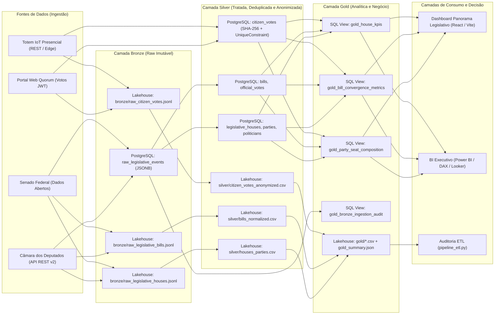
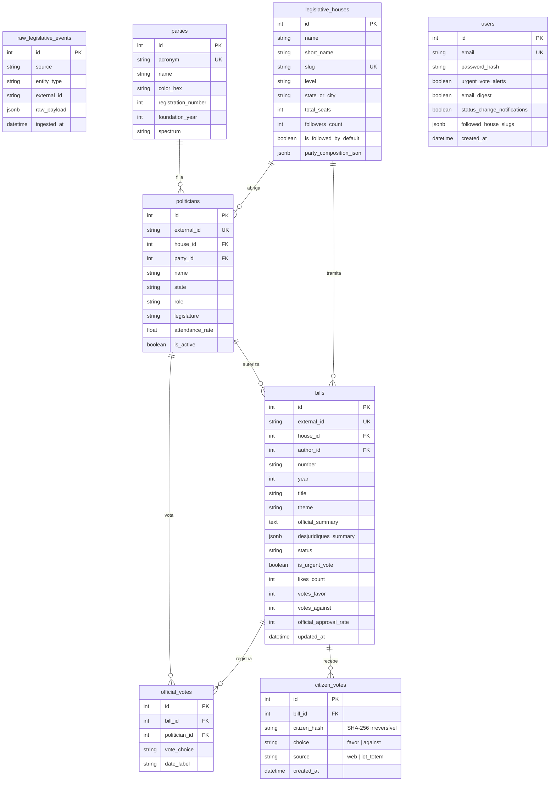

# Arquitetura de Dados — Quorum Lakehouse (Camadas Medallion)

Este documento descreve a arquitetura analítica de Big Data da plataforma **Quorum** (Área 2 — Big Data e Visualização, FIAP Global Solution 2026/2), estruturada no padrão **Medallion (Bronze → Silver → Gold)** para conectar o backend transacional (`PostgreSQL 16` + `FastAPI`), os coletores oficiais da **Câmara dos Deputados** e do **Senado Federal**, o módulo de **IA Desjuridiquês** e o **Dashboard Panorama Legislativo**.

---

## 1. Visão Geral da Arquitetura Medallion

---

## 2. Modelo Entidade-Relacionamento (Camadas Bronze & Silver — PostgreSQL 16)

---

## 3. Dicionário de Dados por Camada

### 3.1 Camada Bronze (`raw`) — Preservação Bruta e Auditoria
| Artefato / Tabela | Origem | Granularidade | Objetivo |
| --- | --- | --- | --- |
| `raw_legislative_events` (PostgreSQL `JSONB`) | Câmara API v2 / Senado API / Seed | 1 evento por entidade ingerida | Armazenamento imutável dos payloads JSON originais para reprocessamento (`replay`) e rastreabilidade (`lineage`). |
| `lakehouse/bronze/raw_legislative_houses.jsonl` | `/api/v1/houses` ou Snapshot | 1 linha JSON por Casa | Histórico bruto da composição partidária e total de cadeiras por esfera legislativa. |
| `lakehouse/bronze/raw_legislative_bills.jsonl` | `/api/v1/bills` ou Snapshot | 1 linha JSON por PL/PEC | Carga bruta de proposições, status de tramitação, votos cidadãos e aprovação oficial. |
| `lakehouse/bronze/raw_citizen_votes.jsonl` | Web + Totem IoT (Stream) | 1 linha JSON por tentativa de voto | Log bruto de eventos de votação antes da deduplicação e anonimização criptográfica. |

### 3.2 Camada Silver (`trusted`) — Saneamento, Normalização e Anonimização LGPD
| Tabela / Arquivo CSV | Regras de Saneamento Aplicadas | Chaves / Constraints |
| --- | --- | --- |
| `legislative_houses` & `parties` | Padronização de siglas (`slug`, `acronym`), validação de esfera (`Federal`, `Estadual`, `Municipal`) e soma de cadeiras por bancada (`seat_count`). | `slug UK`, `acronym UK` |
| `politicians` & `official_votes` | Vinculação referencial a `house_id` e `party_id`, filtro de parlamentares em exercício (`is_active`) e cálculo de assiduidade (`attendance_rate`). | `external_id UK`, `house_id FK`, `party_id FK` |
| `bills` | Normalização de número/ano, classificação temática, anexo do resumo estruturado da IA (`desjuridiques_summary`) e status padronizado (`Votação Agendada`, `Em Tramitação`, `Aprovado`). | `external_id UK`, `house_id FK` |
| `citizen_votes` | Deduplicação estrita de múltiplos cliques/tentativas por usuário/sessão e conversão de identificadores em `citizen_hash` via **SHA-256**. | `UniqueConstraint(bill_id, citizen_hash)` |
| `silver/houses_parties.csv` | Explosão do JSON de composição partidária (`party_composition_json`) em linhas tabulares com `seat_share_pct`. | `(house_slug, party_acronym)` |
| `silver/bills_normalized.csv` | Consolidação limpa de proposições com percentuais validados e contagens saneadas. | `bill_external_id` |
| `silver/citizen_votes_anonymized.csv` | Registro de votos deduplicados (`web` e `iot_totem`) com `citizen_hash` SHA-256 de 64 caracteres hexadecimais e descarte de dados pessoais. | `(bill_external_id, citizen_hash)` |

### 3.3 Camada Gold (`refined` / Consumo Executivo)
| SQL View / Artefato JSON-CSV | Indicadores Materializados | Consumidor Principal |
| --- | --- | --- |
| `gold_party_seat_composition` (`gold/party_seat_composition.csv`) | Participação percentual por partido (`seat_share_pct`) e índice HHI de fragmentação da Casa. | Gráfico Donut & Barras de Bancadas |
| `gold_bill_convergence_metrics` (`gold/bill_convergence_metrics.csv`) | `citizen_favor_pct`, `official_approval_pct`, **Índice de Convergência** (`convergence_index`), faixa de alinhamento e divisão `web` vs. `iot_totem`. | Lista comparativa Enquete Cidadã vs. Adesão Oficial |
| `gold_house_kpis` (`gold/house_kpis.csv`) | KPIs executivos por Casa: total de PLs, votos totais, aprovação oficial média, apoio cidadão médio, convergência média, HHI normalizado e número efetivo de partidos (Laakso-Taagepera). | Cartões KPI e filtros do Panorama Legislativo |
| `gold_bronze_ingestion_audit` | Volume ingerido por fonte, IDs distintos, eventos duplicados detectados e tamanho médio dos payloads JSONB. | Monitoramento de Engenharia de Dados |

---

## 4. Fluxo de Ingestão e Processamento (Raw → Treated)

1. **Extração (Ingestão Bronze):** O worker `backend/app/workers/ingestion.py` e o pipeline `bigdata/pipeline_etl.py` consomem dados oficiais (`Câmara dos Deputados` e `Senado Federal`) e eventos da API REST (`FastAPI`), salvando cada registro sem transformação destrutiva em `raw_legislative_events` (`JSONB`) e arquivos `.jsonl`.
2. **Saneamento e Conformidade LGPD (Bronze → Silver):**
   - **Conversão de Esquema:** Arrays JSON aninhados (`party_composition_json`) são normalizados em registros relacionais/CSV com cálculo de fração de assentos.
   - **Anonimização Criptográfica (LGPD Art. 5º e Art. 7º):** Tokens brutos de eleitor ou sessão (Web JWT ID / Totem Hardware Token) jamais chegam às camadas Silver ou Gold; o pipeline aplica `SHA-256` irreversível gerando `citizen_hash`, descartando qualquer dado identificável (PII).
   - **Deduplicação Determinística:** Chaves únicas compostas `(bill_id, citizen_hash)` eliminam votos duplicados em janelas de concorrência antes da agregação.
3. **Agregação Analítica (Silver → Gold):**
   - As views em `sql/medallion_gold_views.sql` e o estágio Gold do `pipeline_etl.py` cruzam sentimento cidadão, adesão oficial, fragmentação parlamentar e canal de origem (`web` vs. `iot_totem`), alimentando os gráficos e filtros em tempo real do `DashboardPage.tsx`.
