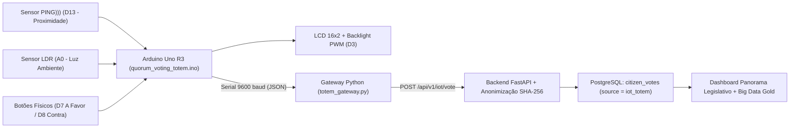

# Módulo IoT — Totem de Votação Cidadã Quorum

Este módulo implementa a camada de **IoT & Hardware Embarcado** (Área 3 — MVP, IoT e Experiência Digital, FIAP Global Solution 2026/2): um **Totem de Participação Cidadã Presencial** construído com **Arduino Uno R3** no TinkerCad para inclusão digital em estações de metrô, terminais de ônibus e equipamentos públicos.

---

## 1. Arquitetura do Circuito (Arduino Uno R3 / TinkerCad)

### Componentes e Pinagem (`quorum_voting_totem.ino`)

| Componente | Pino no Arduino | Função no Totem Quorum |
| --- | --- | --- |
| **Sensor Ultrassônico `PING)))`** | `D13` (`pingPin`) | Detecta aproximação do cidadão (`<= 100 cm`). Tira o totem do standby e bloqueia acionamentos acidentais quando vazio. |
| **Sensor de Luminosidade `LDR`** | `A0` (`ldrPin`) | Mede a luz ambiente (`0–1023`) para adaptar dinamicamente o brilho da tela conforme sol forte ou período noturno. |
| **Backlight PWM do LCD** | `D3` (`backlightPin`) | Controla a luminosidade do display via `analogWrite` (`PWM 30` em economia standby; `80–255` em uso ativo). |
| **Botão `A Favor` (Upvote)** | `D7` (`upvotePin`) | Botão físico `INPUT_PULLUP` com debounce (`200 ms`) que registra voto `"favor"`. |
| **Botão `Contra` (Downvote)** | `D8` (`downvotePin`) | Botão físico `INPUT_PULLUP` com debounce (`200 ms`) que registra voto `"against"`. |
| **Display LCD `16x2` + Potenciômetro** | `D12, D11, D5, D4, D6, D2` | Exibe boas-vindas (`Quorum`), projeto ativo (`PL 2338/2023`), placar local e confirmação de voto (`Voto registrado!`). |

---

## 2. Fluxo de Telemetria (Sensores → Gateway → Backend PostgreSQL)



---

## 3. Como Executar

### 3.1 Simulação Automática + Integração Real com o Backend (Recomendado para Demos e Pitch)
Com o backend FastAPI ativo em `http://localhost:8000` (ou offline em modo demonstração):

```powershell
cd iot
python totem_gateway.py
```

O gateway executa a sequência completa:
1. Valida o bloqueio de segurança em **Modo Standby** (`185 cm > 100 cm`).
2. Simula **3 votos presenciais** com diferentes condições de luz (**LDR Pin A0** -> ajuste **PWM Pin 3**) e exibe o visor **LCD 16x2** no terminal.
3. Envia os votos via `POST http://localhost:8000/api/v1/iot/vote` com `source="iot_totem"`, atualizando imediatamente o placar da proposição no **Feed** e os indicadores omnichannel do **Panorama Legislativo**.

### 3.2 Modo Kiosk Interativo (Ao Vivo no Pitch)
Permite apertar `1` (`A Favor`) ou `2` (`Contra`) e alterar a distância (`d <cm>`) ou luz ambiente (`l <0-1023>`) manualmente:

```powershell
cd iot
python totem_gateway.py --interactive
```

### 3.3 Hardware Físico / TinkerCad (`quorum_voting_totem.ino`)
1. Carregue o código de [`quorum_voting_totem.ino`](./quorum_voting_totem.ino) no projeto Arduino Uno R3 do **TinkerCad Circuits** ou na **Arduino IDE**.
2. Ao testar no hardware real via USB (ex.: `COM3`), conecte o gateway diretamente à porta serial:

```powershell
pip install pyserial
python totem_gateway.py --serial COM3
```
